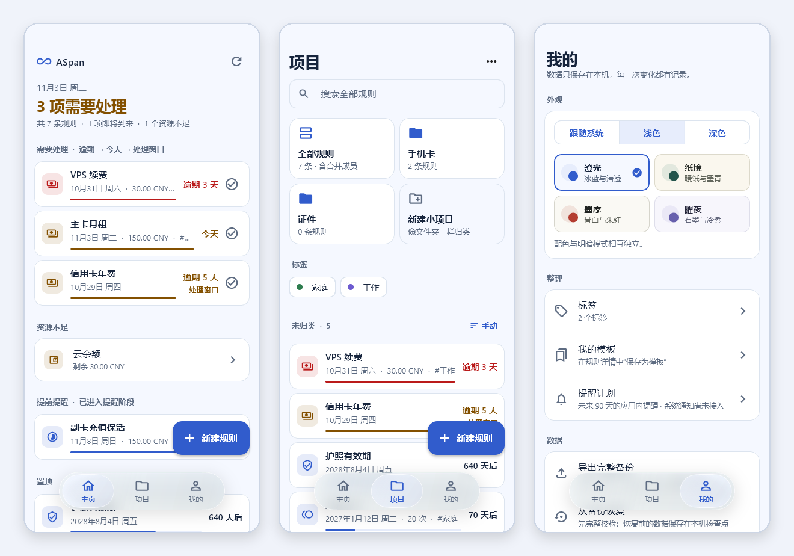

<div align="center">


# ASpan

**把生活中的周期、余额与有效期，放在一起。**

离线的时间与资源管理应用，使用 Flutter 与 Rust 构建。

[](LICENSE) [](#download) [](https://github.com/SteamDoge/aspan/releases/tag/rc0.0.5)

[功能](#features) · [界面预览](#preview) · [下载](#download) · [从源码构建](#build) · [反馈](#feedback)

</div>

<a id="preview"></a>

<p align="center">
  <picture>
    <source media="(prefers-color-scheme: dark)" srcset="docs/images/preview-dark.png">
    
  </picture>
</p>

<p align="center"><sub>主页 · 项目 · 我的。截图使用示例数据，由界面测试生成；不代表各设备的实机验收结果。</sub></p>

<a id="features"></a>

## 功能

- **一个入口管理日常周期**：订阅缴费、待办、生日、检查维护、次数卡与证件有效期，内置 23 个场景模板，也可保存自己的模板。
- **日期与资源一起看**：单次、日、周、月、年及完成后重置等周期，配合余额、次数和有效期，查看当前期进度与应用内提醒计划。
- **把事情整理清楚**：用项目和标签分类，搜索全部规则，将相关规则合并展示，并保留各自的历史。
- **每次变动都有记录**：确认完成、充值或扣费后记录流水；纠错保留原始记录与修正过程，预测不会直接记账。
- **数据保存在本机**：SQLite 存储，支持导出和恢复完整 JSON 备份；恢复前检查备份，并保留恢复前检查点。
- **适应手机与桌面**：澄光、纸境、墨序、曜夜四套配色，独立明暗模式，窄屏悬浮导航与宽屏侧栏。

<a id="download"></a>

## 下载

当前候选版：[**rc0.0.5**](https://github.com/SteamDoge/aspan/releases/tag/rc0.0.5)（0.0.5-rc.1+9）。按平台选择下表附件，完整更新说明、校验清单与源码对应关系见版本页面。

| 平台 | 支持范围 | 包格式与选择方式 |
| --- | --- | --- |
| Android | Android 7.0 / API 24 及以上，ARM64 | [](https://github.com/SteamDoge/aspan/releases/download/rc0.0.5/ASpan-rc0.0.5-android-arm64-v8a.apk)，多数当前 Android 手机 |
| Android | Android 7.0 / API 24 及以上，x86_64 | [](https://github.com/SteamDoge/aspan/releases/download/rc0.0.5/ASpan-rc0.0.5-android-x86_64.apk)，对应设备或模拟器 |
| Windows | Windows 10 / 11，x64 | [](https://github.com/SteamDoge/aspan/releases/download/rc0.0.5/ASpan-rc0.0.5-windows-x64.zip)，解压运行 `aspan.exe`，保留 DLL 与 `data/` |

[SHA-256 校验清单](https://github.com/SteamDoge/aspan/releases/download/rc0.0.5/SHA256SUMS) · [所有版本](https://github.com/SteamDoge/aspan/releases)

当前没有 ARMv7、Windows ARM64、macOS、Linux 或 iOS 版本。升级前请导出备份；Android 旧 Debug 签名不能直接覆盖，Windows 便携包未做代码签名。

## 开始使用

1. 在 **项目** 页新建规则，或选择场景模板，核对日期、周期与资源设置。
2. 在 **主页** 查看需要处理的当前期，确认完成、充值、扣费或跳过。
3. 在 **我的** 调整外观、管理模板，并定期导出完整备份。

模板会保留保存时的配置日期，使用前请核对。Windows 数据位于平台应用支持目录中的 `ASpan/v1/aspan.sqlite3`，Android 数据位于应用私有目录；卸载 Android 应用通常会清除数据，请先导出备份。

<a id="status"></a>

## 当前状态

当前源码版本：**0.0.5-rc.1+9**，处于候选阶段。

- 提醒计划目前仅在应用内展示；**系统通知、具体时刻、时区 / DST 和自动记账尚未实现**。
- 公开源码已通过 Rust / Flutter 自动检查、Windows x64 Release 构建及 Android ARM64 / x86_64 Debug 构建。
- rc0.0.5 原包已验证 Windows 随包 DLL / SQLite，以及 Android API 35 x86_64 的升级、导航与重开流程；ARM64 真机、最终 Windows GUI 与完整设备矩阵尚未验收。详细范围见 [Release](https://github.com/SteamDoge/aspan/releases/tag/rc0.0.5)。

<a id="build"></a>

## 从源码构建

已验证环境：**Flutter 3.47.7**（Dart 3.13.5）、**Rust 1.98.1**、**PowerShell 7**。当前脚本在 Windows 主机上构建 Windows 与 Android；依赖由 `Cargo.lock` 和 `pubspec.lock` 锁定。

| 目标 | 额外环境 |
| --- | --- |
| Windows x64 | Visual Studio“使用 C++ 的桌面开发”、Windows SDK、Rust MSVC 工具链 |
| Android | JDK 21、Android SDK、NDK 28.2.13676358，Rust 目标 `aarch64-linux-android` 与 `x86_64-linux-android` |

```powershell
git clone https://github.com/SteamDoge/aspan.git
cd aspan
pwsh -File scripts/check.ps1
pwsh -File scripts/run.ps1
```

将 `flutter`、`cargo` 放进当前进程的 PATH，或为脚本传入 `-Flutter`。首次恢复依赖需要网络或完整缓存；同一 Flutter 工程的检查与构建请串行执行。

<details>
<summary><b>构建 Windows / Android 安装包</b></summary>

```powershell
pwsh -File scripts/build.ps1 -Platform windows
pwsh -File scripts/build.ps1 -Platform android -Configuration Debug `
  -AndroidSdk '<已安装的 Android SDK 目录>' -Java '<已安装的 JDK 目录>'
```

Windows 输出：`apps/aspan/build/windows/x64/runner/Release/`。运行时保留整个目录的 DLL 与 `data/`。

Android 输出：`apps/aspan/build/app/outputs/flutter-apk/`，按 ARM64 与 x86_64 分包。当前使用 AGP 9.1.0、Kotlin 2.4.0、Gradle 9.3.1，Gradle 分发 SHA-256 已固定。Flutter 在构建时从 SDK 缓存补齐 Gradle wrapper 启动文件，仓库不重复存储 JAR 或生成脚本。

可在忽略入库的 `.tools/toolchains.json` 中设置 `flutter`、`java`、`androidSdk` 三个本机路径；无需将 SDK 放进仓库。Windows 插件链接由脚本创建，需要系统允许符号链接或 junction。

**Android Release 签名**：在 `apps/aspan/android/key.properties` 配置自己的 `storeFile`、`storePassword`、`keyAlias`、`keyPassword`，使用 keystore 绝对路径，再将 `-Configuration Debug` 改为 `Release`。不要提交配置或私钥。不同证书签名的安装包无法直接覆盖升级，操作前先备份数据。

构建脚本只生成本地产物。对外发行须对应已提交的公开源码与明确 Tag，从该 Tag 的干净源码构建，并记录环境、签名身份与 SHA-256；安装包通过 Releases 附件分发。

</details>

<details>
<summary><b>架构、检查入口与数据说明</b></summary>

| 目录 | 职责 |
| --- | --- |
| `apps/aspan` | Flutter 界面与平台交互，通过 `dart:ffi` 调用 `aspan_bridge` |
| `crates/core` | 日期周期、规则、整数精度资源、幂等记账、纠错与完整性校验 |
| `crates/runtime` | SQLite 事务、JSON C ABI、备份与 CLI |
| `scripts` | 检查、运行与本地构建入口 |

`scripts/check.ps1` 执行 Rust 格式、测试、Clippy、原生库构建及 Dart 格式、分析、Flutter 测试。`scripts/run.ps1` 构建原生库后运行 Windows 应用；直接运行 Flutter 会遗漏 Rust 库准备。`scripts/native-check.ps1` 使用独立临时数据执行 Windows 集成测试。

```powershell
pwsh -File scripts/native-check.ps1
cargo test --workspace --locked
```

检查与构建使用 `--locked`、`--enforce-lockfile`。金额与资源使用整数最小单位；预测不写账本，删除规则保留已发生的流水，纠错追加反向和替代流水。

导出 / 导入为版本化 JSON，导入上限 50 MiB；恢复前完整校验并保留检查点。目前没有检查点的应用内回退或自动淘汰入口。

</details>

<a id="feedback"></a>

## 反馈与参与

欢迎通过 [GitHub Issues](https://github.com/SteamDoge/aspan/issues) 报告问题或提出建议。反馈时请附上应用版本、平台、架构与复现步骤；日志和截图中请隐去个人数据。代码改进可通过 Pull Request 提交。

## 许可证

ASpan 应用代码采用 **AGPL-3.0-only**，完整许可证见 [LICENSE](LICENSE)，不附加禁止商用或限制修改的条款。

第三方代码、Flutter 生成的平台模板、引擎、字体与素材保留各自的许可证和版权声明，见 [THIRD_PARTY_NOTICES.md](THIRD_PARTY_NOTICES.md) 与 [licenses/](licenses/)。具体二进制发行仍须核对其包含的组件及运行库声明。

当前没有 HTML / JavaScript 插件机制；独立第三方插件的许可证与接口边界应分别判断。
