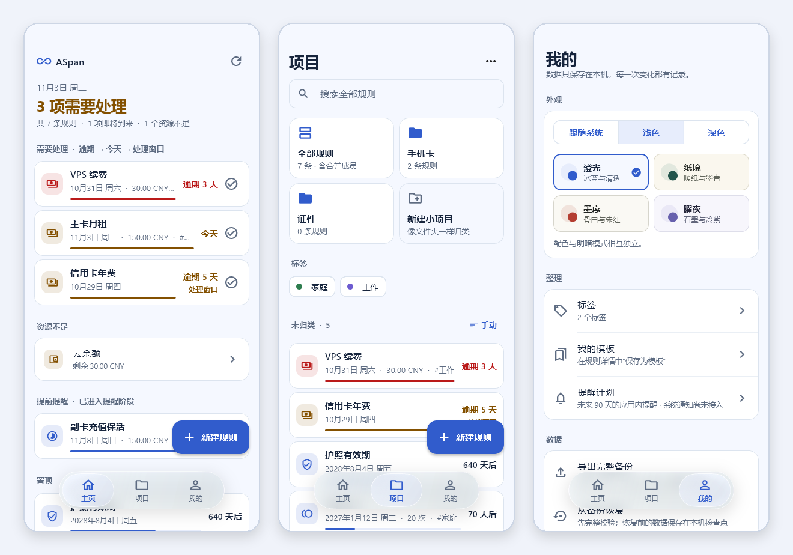

<div align="center">


# ASpan

**把生活中的周期、余额与有效期，放在一起。**

离线的时间与资源管理应用，使用 Flutter 与 Rust 构建。

[](https://github.com/SteamDoge/aspan/releases) [](https://github.com/SteamDoge/aspan/releases) [](LICENSE)<br>
 

**[下载](#下载)** &nbsp;·&nbsp; **[功能](#功能)** &nbsp;·&nbsp; **[使用](#使用)** &nbsp;·&nbsp; **[源码构建](#源码构建)** &nbsp;·&nbsp; **[问题反馈](https://github.com/SteamDoge/aspan/issues)**

[English](README.md) · **简体中文**

<picture>
  <source media="(prefers-color-scheme: dark)" srcset="docs/images/preview-dark.png">
  
</picture>

<sub>主页 · 项目 · 我的。截图使用示例数据，由界面测试生成，不代表各设备的实机验收结果。</sub>

</div>

## 适合你吗

订阅续费、证件到期、次数卡余量、家里设备的检查维护，往往分散在日历、备忘录和各个应用里，哪天该处理、还剩多少，很难一眼看清。ASpan 把这些都放进同一个本地应用：

- **按周期提醒你该处理什么**：主页列出当前期需要确认的事项。
- **日期和余量一起记**：周期旁边就是余额、次数和有效期。
- **每次变动都留记录**：充值、扣费和纠错都有流水可查。
- **不需要账号，不联网**：数据只保存在你的设备上。

如果你想把各种按周期发生的事和剩余额度集中管理，它适合你。如果你需要系统通知、精确到时刻的提醒或多设备同步，目前还做不到。界面目前只有简体中文。支持 Android 7.0+ 和 Windows 10／11 x64。

## 功能

- **一个入口管理日常周期**：订阅缴费、待办、生日、检查维护、次数卡与证件有效期；内置 23 个场景模板，也可保存自己的模板。
- **日期与资源一起看**：单次、日、周、月、年及完成后重置等周期，配合余额、次数和有效期，查看当前期进度与应用内提醒计划。
- **把事情整理清楚**：用项目和标签分类，搜索全部规则，把相关规则合并展示，并保留各自的历史。
- **每次变动都有记录**：确认完成、充值或扣费后记录流水；纠错保留原始记录与修正过程，预测不会直接记账。
- **数据保存在本机**：导出和恢复完整 JSON 备份；恢复前先检查备份，并保留恢复前的检查点。
- **适应手机与桌面**：澄光、纸境、墨序、曜夜四套配色，明暗模式可单独切换；窄屏用悬浮导航，宽屏用侧栏。
- **开放源码**：原创代码采用 **AGPL-3.0-only**，第三方许可与版权声明完整保留。

提醒计划目前只在应用内显示，**系统通知、具体时刻、时区／夏令时和自动记账尚未实现**。恢复前的检查点暂时没有应用内回退入口。界面暂时只有简体中文。所有功能都不需要联网。

## 下载

当前版本：[**rc0.0.5**](https://github.com/SteamDoge/aspan/releases/tag/rc0.0.5)（0.0.5-rc.1+9）。在 [所有版本](https://github.com/SteamDoge/aspan/releases) 查看更新与安装包。

| 平台 | 下载 | 选择说明 |
| --- | --- | --- |
| Android 7.0+（API 24+） | [](https://github.com/SteamDoge/aspan/releases/download/rc0.0.5/ASpan-rc0.0.5-android-arm64-v8a.apk) | 大多数手机选择此版本 |
| Android x86_64 | [](https://github.com/SteamDoge/aspan/releases/download/rc0.0.5/ASpan-rc0.0.5-android-x86_64.apk) | x86_64 设备／模拟器 |
| Windows 10／11 x64 | [](https://github.com/SteamDoge/aspan/releases/download/rc0.0.5/ASpan-rc0.0.5-windows-x64.zip) | 解压完整目录，运行 `aspan.exe` |

<sub>Windows 便携包须完整解压，保留 DLL 与 `data/`；未做代码签名，首次运行可能出现系统提示。当前没有 ARMv7、Windows ARM64、macOS、Linux 或 iOS 版本。ARM64 实体机、最终 Windows 图形界面与完整设备矩阵尚未验收，范围见 [Release](https://github.com/SteamDoge/aspan/releases/tag/rc0.0.5)。安装包可用 [SHA256SUMS](https://github.com/SteamDoge/aspan/releases/download/rc0.0.5/SHA256SUMS) 校验。</sub>

## 使用

**1 · 安装。** Android 安装对应的 APK；Windows 解压便携包，保留 `aspan.exe` 旁边的 DLL 和 `data/`，只复制 EXE 无法运行。

**2 · 添加规则。** 在 **项目** 页新建规则或选择场景模板，核对日期、周期与资源设置。<br><sub>模板会保留保存时的配置日期，使用前请核对。</sub>

**3 · 处理当前期。** 在 **主页** 查看需要处理的事项，确认完成、充值、扣费或跳过。

**4 · 备份。** 在 **我的** 调整外观、管理模板，并定期导出完整备份。

升级前先导出备份。旧版 Debug 签名的 Android 安装包不能被新版直接覆盖；卸载 Android 应用通常会清除数据，不要用卸载代替备份。

## 源码构建

<details>
<summary>展开环境要求、构建命令与测试步骤</summary>

### 构建环境

本版本使用 **Flutter 3.47.7**（Dart 3.13.5）、**Rust 1.98.1** 和 **PowerShell 7** 验证。依赖版本锁定在 `Cargo.lock` 和 `apps/aspan/pubspec.lock`，首次恢复依赖需要联网或完整缓存。当前脚本在 Windows 主机上构建 Windows 与 Android。

- Windows：Visual Studio 的“使用 C++ 的桌面开发”工作负载、Windows SDK、Rust MSVC 工具链。脚本会创建插件 junction，系统需允许创建符号链接或 junction。
- Android：JDK 21、Android SDK、NDK **28.2.13676358**，Rust 目标 `aarch64-linux-android` 与 `x86_64-linux-android`；工程固定 AGP 9.1.0、Kotlin 2.4.0、Gradle 9.3.1，Gradle 分发包的 SHA-256 已固定。
- 把 `flutter`、`cargo` 放进当前进程的 PATH，或给脚本传 `-Flutter`。也可以在被 Git 忽略的 `.tools/toolchains.json` 里设置 `flutter`、`java`、`androidSdk` 三个本机路径，不需要把 SDK 放进仓库。

### 构建

```powershell
git clone https://github.com/SteamDoge/aspan.git
cd aspan

# 开发运行：先构建 Rust 原生库，再启动 Windows 应用
pwsh -File scripts/run.ps1

# Windows 安装包
pwsh -File scripts/build.ps1 -Platform windows

# Android 安装包（Debug 签名）
pwsh -File scripts/build.ps1 -Platform android -Configuration Debug `
  -AndroidSdk 'YOUR_ANDROID_SDK_DIR' -Java 'YOUR_JDK_DIR'
```

Windows 输出位于 `apps/aspan/build/windows/x64/runner/Release/`，运行时保留整个目录的 DLL 与 `data/`。Android 输出位于 `apps/aspan/build/app/outputs/flutter-apk/`，按 ARM64 与 x86_64 分包。直接运行 `flutter run` 会跳过 Rust 库的准备，请用 `scripts/run.ps1`。同一 Flutter 工程的检查与构建请串行执行。

### Android 签名

Release 构建前请自行生成并安全保管签名密钥，创建被 Git 忽略的 `apps/aspan/android/key.properties`：

```properties
storeFile=C:/YOUR_PATH/your-release-key.jks
storePassword=YOUR_STORE_PASSWORD
keyAlias=YOUR_KEY_ALIAS
keyPassword=YOUR_KEY_PASSWORD
```

`storeFile` 用 keystore 的绝对路径，然后把上面命令里的 `-Configuration Debug` 改成 `Release`。这些占位符不是可用凭据，不要提交此文件或密钥。不同证书签名的安装包不能直接覆盖升级，需要保留数据时先在应用内导出备份。

### 测试

一键完整检查（Rust 格式、测试、Clippy、原生库构建，Dart 格式、Flutter 分析与测试）：

```powershell
pwsh -File scripts/check.ps1
```

也可以分步执行（插件 junction 和依赖恢复由脚本处理，建议优先使用脚本）：

```powershell
cargo fmt --all -- --check
cargo test --workspace --locked
cargo clippy --workspace --all-targets --locked -- -D warnings
cargo build -p aspan-runtime --locked
$env:ASPAN_RUST_LIB = (Resolve-Path target/debug/aspan_bridge.dll).Path
Push-Location apps/aspan
flutter pub get --enforce-lockfile
dart format --output=none --set-exit-if-changed lib test integration_test
flutter analyze
flutter test
Pop-Location
```

Windows 集成测试用 `pwsh -File scripts/native-check.ps1` 运行，使用独立的临时数据，不碰个人数据。

</details>

## 工程结构

| 路径 | 职责 |
| --- | --- |
| `apps/aspan` | Flutter 界面与平台交互，通过 `dart:ffi` 调用 Rust 原生库 |
| `crates/core` | 日期周期、规则、整数精度资源、幂等记账、纠错与完整性校验 |
| `crates/runtime` | SQLite 事务、JSON C ABI、备份与 CLI |
| `scripts` | 检查、运行、本地构建与候选版打包校验 |
| `licenses` | 第三方许可证原文 |

## 隐私

ASpan 不联网：不需要账号，不收集使用统计或崩溃报告，也没有任何会发送数据的功能。规则、流水和设置保存在本机的 SQLite 数据库中，只有你主动导出的 JSON 备份会离开应用。

<sub>Windows 数据位于系统应用支持目录下的 `ASpan/v1/aspan.sqlite3`；Android 数据位于应用私有目录。备份导入上限 50 MiB。</sub>

## 反馈与贡献

请通过 [GitHub Issues](https://github.com/SteamDoge/aspan/issues) 提交问题或建议，注明应用版本、平台、架构、复现步骤与预期结果；日志和截图请先隐去个人数据。欢迎提交聚焦问题的 Pull Request；新增的原创源文件请在开头保留 `SPDX-License-Identifier: AGPL-3.0-only` 与版权注释，提交前运行 `pwsh -File scripts/check.ps1`。

如果 ASpan 对你有用，点一个 ⭐ 能让更多人找到它。

## 许可证

本项目原创代码采用 **AGPL-3.0-only**，完整 GNU 官方原文见 [LICENSE](LICENSE)。没有额外的非商用或禁止修改限制。分发修改版以及通过网络向用户提供修改版服务时，应遵守许可证适用的源码提供义务。

第三方代码、依赖、Flutter 工程模板、引擎、字体与素材保留各自原有许可和版权声明（见 [THIRD_PARTY_NOTICES.md](THIRD_PARTY_NOTICES.md) 与 [licenses/](licenses/)），本项目的许可证不改变它们的许可。具体二进制发行仍须核对其包含的组件及运行库声明。
